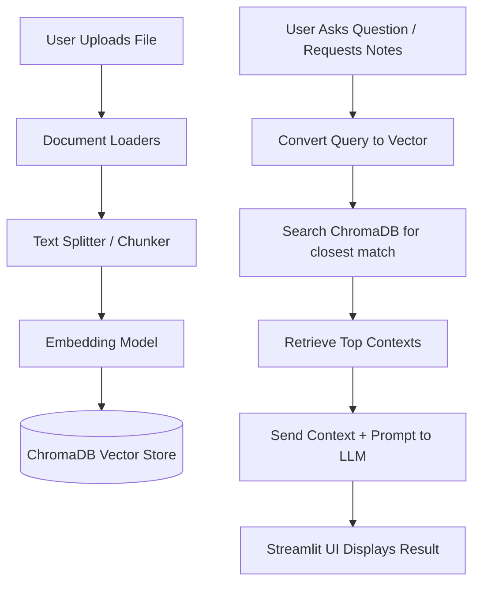

# StudyLens: Architecture & RAG Beginner's Guide

Welcome to the **StudyLens** project! Since you're new to AI, RAG, and LLMs, this document is designed to explain exactly what this project is, how it works under the hood, and what technologies power it—in plain, easy-to-understand language.

---

## 1. What are LLMs and RAG? (Beginner's Guide)

Before diving into the code, let's understand the two core concepts driving this application.

### What is an LLM? (Large Language Model)
An LLM is an AI "brain" that has read a massive amount of text from the internet. Examples include ChatGPT (by OpenAI) or LLaMA 3 (by Meta). 
* **The Problem:** While LLMs are smart, they *only* know what they were trained on up to a certain date. If you ask an LLM about your personal biology notes or a private company document, it has no idea what you're talking about, and it might "hallucinate" (make up a fake answer).

### What is RAG? (Retrieval-Augmented Generation)
**RAG** is the solution to the LLM problem. It's a technique that allows us to give the AI a "cheat sheet" (your uploaded documents) before it answers your question.
Here is how RAG works in 3 simple steps:
1. **Retrieve (R):** You ask a question. The system quickly searches through your uploaded documents and pulls out the most relevant paragraphs.
2. **Augment (A):** The system takes your original question and *attaches* those relevant paragraphs to it as a background context.
3. **Generate (G):** The system hands this massive prompt (Question + Context) to the LLM. The LLM reads the context and generates an accurate, cited answer based *only* on your documents.

---

## 2. StudyLens: High-Level Architecture

StudyLens is an offline-capable, AI-powered study assistant built using a complete RAG pipeline. It takes raw files (PDFs, PowerPoints, Words Docs, and Images), processes them, and uses an LLM to generate notes, flashcards, diagrams, and study schedules.

### The RAG Data Flow in StudyLens

#### Step-by-Step Breakdown:
1. **Ingestion (`core/ingestion/`):** When you upload a file, different Python libraries extract the text (e.g., PyMuPDF for PDFs, EasyOCR to read handwritten text from images).
2. **Chunking (`core/chunker.py`):** We can't feed an entire 100-page book into the AI at once. We use LangChain's `RecursiveCharacterTextSplitter` to chop the text into small "chunks" (blocks of 600 characters).
3. **Embedding (`core/embedder.py`):** The system converts the text chunks into "Vectors" (long lists of numbers) using a HuggingFace model (`all-MiniLM-L6-v2`). This allows the computer to understand the *meaning* of the text, not just exact keywords.
4. **Vector Store (`core/vectorstore.py`):** These number lists are saved in a database called **ChromaDB**. 
5. **Retrieval (`core/retriever.py`):** When you want to generate flashcards, the system converts your request into numbers, finds the most mathematically similar chunks in ChromaDB, and pulls them out.
6. **Generation (`core/llm.py`):** The chunks are sent to the AI (either your local Ollama/Llama 3 or OpenAI API) to generate the final output.

---

## 3. The Tech Stack

Here is exactly what technologies we used to build StudyLens and why:

### Frontend (User Interface)
* **Streamlit:** A Python framework that lets us build web apps using only Python code. We used custom CSS (`theme.css`) to add "glassmorphism" (frosted glass effects), gradients, and animations.

### The AI / Backend (RAG Pipeline)
* **LangChain:** The "glue" framework for AI. It provides all the tools we need to connect document loaders, chunkers, and LLMs together easily.
* **Ollama (Llama 3):** An open-source tool that lets you run powerful AI models entirely on your own laptop for free, ensuring your documents never go to the cloud (100% privacy).
* **OpenAI API (GPT-4o-mini):** An optional cloud fallback if you want faster/smarter generation using an API key.

### Data Processing & Storage
* **ChromaDB:** Our Vector Database. It stores the embedded document chunks locally in an SQLite file (`vectorstore/chroma_db/`).
* **Sentence-Transformers (HuggingFace):** A lightweight, open-source model that translates English sentences into mathematical vectors locally on your CPU.
* **EasyOCR & PyTorch:** Used to detect and read handwriting from uploaded image files (JPG/PNG).

### Advanced Feature Libraries
* **RAGAS:** A specialized evaluation framework. It mathematically scores how "Faithful" the AI's answers are to your documents to prevent hallucinations.
* **Mermaid.js:** A text-to-diagram language we use to generate visual flowcharts.
* **FPDF2:** A library used to export your personalized study plan into a beautifully formatted PDF.

---

## 4. Directory Structure

If you want to read the code, here is where everything lives:

* `app.py` — The main starting point of the app. It handles the web page layout and tabs.
* `config.py` — Central settings (like chunk size, upload folders, default AI models).
* `ui/` — Contains the frontend code.
  * `components/` — The code for the chat interface, flashcard animations, sidebar, and quizzes.
  * `styles/theme.css` — The premium styling file.
* `core/` — The "engine" of the RAG pipeline.
  * `ingestion/` — Scripts to read text from PDFs, PPTs, DOCs, and Images.
  * `chunker.py`, `embedder.py`, `vectorstore.py`, `retriever.py` — The data processing steps.
  * `llm.py` — Connects to Ollama or OpenAI.
* `features/` — The actual app functionalities (Notes generator, Diagram maker, Flashcards, Study Plan, etc.).
* `vectorstore/chroma_db/` — Where your processed document database is saved.
* `data/uploads/` — Where your raw uploaded PDFs and images are temporarily saved.
